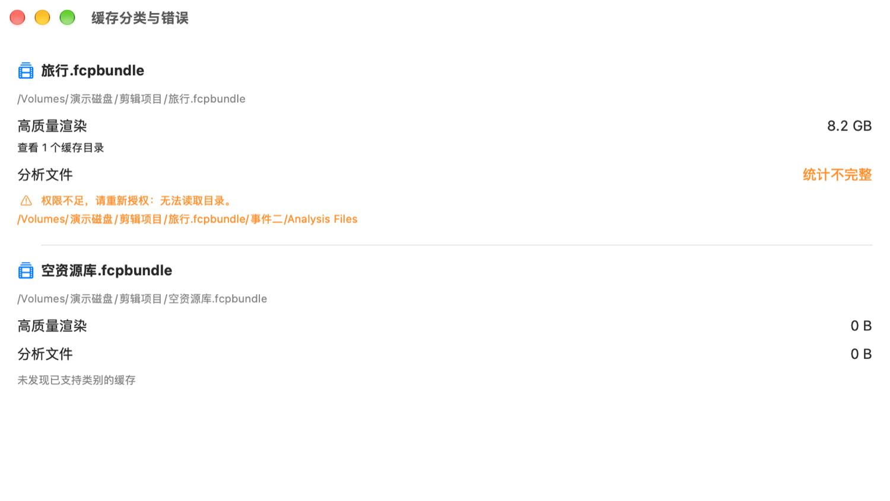

# FCP Cleaner

原生 macOS 应用，用系统文件夹选择面板授权、扫描 Final Cut Pro 资源库中的两类生成文件，预览后可将明确选择的缓存移到系统废纸篓。作者：Steve。首版：**0.1.0（构建 1）**。

## 下载与更新

[项目主页](https://Xiong-mk.github.io/fcp-cleaner/) · [v0.1.0 预发布版](https://github.com/Xiong-mk/fcp-cleaner/releases/tag/v0.1.0) · [对应源码](https://github.com/Xiong-mk/fcp-cleaner/releases/download/v0.1.0/FCP-Cleaner-v0.1.0-source.zip)

正式 feed 已配置，本地签名 ZIP 已验证；GitHub Pages 与 Releases 线上部署待验收。应用 ZIP 为 **macOS 14+、Apple Silicon / Intel 通用版本**，使用 **ad-hoc 签名，未经过 Apple 公证**。其他设备的 Gatekeeper、最低系统和实际升级安装尚未验收，不建议关闭系统安全设置。发布状态和检查项目见 [发布清单](docs/release.md)。

## 能做什么

- 添加多个资源库父文件夹，持久保存 security-scoped bookmark，按真实路径去重。
- 只发现父目录的直接子项 `.fcpbundle`，按事件统计高质量渲染与分析文件的估算占用。
- 显示权限、断盘和扫描错误；不将读取失败显示为 `0 B`。
- 清理默认未选；预览、原始快照复验、退出 FCP 检查、二次确认后逐项调用 `FileManager.trashItem`，等待结果、记录日志、重新扫描。
- 支持满足检查条件的本地可写内置盘和外接 SSD/HDD；停止后续项不会撤回已经完成的移动。
- 集成 Sparkle 2，提供「软件更新」设置和「检查更新…」菜单；更新源配置为 GitHub Pages；说明见 [Sparkle 集成](docs/sparkle.md)。

仅匹配以下两种目录（`Library` 必须是已授权父文件夹的直接子项）：

```text
Library.fcpbundle/<事件>/Render Files/High Quality Media
Library.fcpbundle/<事件>/Analysis Files
```

不清理原始素材、代理/优化媒体、数据库或备份，也不查找外部缓存。界面会标明「外部位置未检查」。高质量渲染涵盖匹配目录中的全部渲染，不能判断哪些未使用；后续打开 FCP 可能需要重新渲染或分析。需要使用 FCP 自身的「删除生成的资源库文件」时，请在 FCP 中操作。

分类结果预览（Xcode 演示数据，路径与容量均为虚构）：



## 系统与构建要求

部署目标为 **macOS 14.0+**；开发构建使用 **Xcode 27.1 / Swift 6.4**（使用 Swift Testing 与 isolated deinit，Swift 语言模式为 5；更早版本未验证）。本次实际验证环境和结果见 [任务七验证记录](docs/task-seven-validation.md)。独立 macOS 14、Intel Mac 和外接盘物理拔插尚需设备验收。

从仓库根目录打开：

```sh
open "FCP Cleaner/FCP Cleaner.xcodeproj"
```

选择共享的 **FCP Cleaner → My Mac**，Command-B 构建，Command-R 运行，Command-U 测试。测试 target 已显式依赖应用宿主，首次检出无需先手动构建宿主。个人本地构建不要求开发团队；工程使用本机签名。正式二进制发布前应确认自己的 Bundle ID、Developer ID 签名及公证策略。

首次构建会通过 Swift Package Manager 下载 Sparkle；已提交 `Package.resolved`，当前锁定 **2.10.0**。自动更新默认检查开启、自动下载关闭；正式更新源为 `https://Xiong-mk.github.io/fcp-cleaner/appcast.xml`。该源的线上验收状态见发布清单；未填写或无效的更新配置不会启动更新器。

命令行构建（不启动应用，不读取已保存的授权）：

```sh
xcodebuild -project "FCP Cleaner/FCP Cleaner.xcodeproj" \
  -scheme "FCP Cleaner" -configuration Release \
  -destination 'platform=macOS' -derivedDataPath build/Release build
```

制作带拖拽安装界面、弯箭头和中文安装说明的 ad-hoc 测试版 DMG，见 [DMG 制作与验收](docs/dmg.md)。

运行全部测试并使用独立应用身份隔离已有授权记录：

```sh
./scripts/test.sh
```

测试只使用模拟依赖和临时虚拟 `.fcpbundle`；部分集成测试会将本次创建的测试缓存移到系统废纸篓，保留测试数据供核对，不清空废纸篓。测试宿主的权限不等同于正常应用的原生面板授权验收。

## 使用流程与边界

1. 点击「添加资源库」，选存放 `.fcpbundle` 的**父文件夹**；每次可选一个位置，可反复添加。
2. 检查分类容量、完整路径及错误；缓存存在时打开「预览并选择清理」。预览和勾选只读。
3. 结束编辑、渲染和导出并退出 Final Cut Pro，勾选通过项，阅读二次确认并勾选退出声明，再确认移到废纸篓。
4. 等待所有结果和重扫完成；失败项显示原因。废纸篓失败不会降级永久删除，也不自动重试。

网络卷、只读卷、必要属性未知的卷以及识别出的云盘位置会被拒绝。第三方同步位置无法全部识别，请勿使用同步工具管理的目录。符号链接、Finder 别名、路径越界和扫描后对象改变会被拒绝。路径复验与系统移动之间仍有并发变化窗口，并非原子文件系统事务。

「估算占用」及「已移入废纸篓的估算容量」都不等于实际释放空间；APFS 克隆、硬链接、压缩、快照及废纸篓均影响实际可用空间。

授权、最近扫描诊断及逐项清理日志只保存在沙盒的 `Application Support/<Bundle ID>/` 下，不上传。日志含本地路径；提交 Issue 前请脱敏，不要上传书签、真实资源库、媒体、证书或私钥。详见[安全与隐私](docs/security.md)。

## 工程与参与

```text
FCP Cleaner/
  FCP Cleaner.xcodeproj/     共享 macOS scheme
  FCP Cleaner/
    App/                    入口与退出生命周期
    UI/                     原生选择与 SwiftUI 界面
    Models/                 资源库、缓存和扫描结果
    Services/               授权、扫描、安全复验、废纸篓和日志
    ViewModels/             扫描与清理流程调度
    Resources/              图标、随程序分发的许可资料
  FCPCleanerTests/           Swift Testing 单元与虚拟库集成测试
docs/                       架构、安全、验证和发布清单
scripts/                    隔离测试与源码发布包审查
```

[架构](docs/architecture.md) · [贡献指南](CONTRIBUTING.md) · [第三方声明](THIRD_PARTY_NOTICES.md) · [发布清单](docs/release.md) · [GitHub 发布流程](docs/publishing.md) · [更新记录](CHANGELOG.md)

## 许可证

Copyright (C) 2026 Steve。项目源代码、测试、脚本和文档使用 **GPL-3.0-or-later**。图标的 AI 生成来源见第三方声明。

This program is free software: you can redistribute it and/or modify it under the terms of the GNU General Public License as published by the Free Software Foundation, either version 3 of the License, or (at your option) any later version.

This program is distributed in the hope that it will be useful, but WITHOUT ANY WARRANTY; without even the implied warranty of MERCHANTABILITY or FITNESS FOR A PARTICULAR PURPOSE. See the GNU General Public License for more details.

You should have received a copy of the GNU General Public License along with this program. If not, see <https://www.gnu.org/licenses/>.

根目录 [LICENSE](LICENSE) 保留 GNU 官方 GPLv3 全文；项目选择由上述声明与各源文件的 SPDX 明确为 [GPL-3.0-or-later](https://spdx.org/licenses/GPL-3.0-or-later.html)。应用菜单可查看随程序打包的许可证。二进制分发应同时提供匹配版本的完整对应源码、构建脚本及许可资料，详情见发布清单。

本项目为独立项目，与 Apple Inc. 无隶属或认可关系。Final Cut Pro、macOS、Xcode 等名称属于相应权利人。
