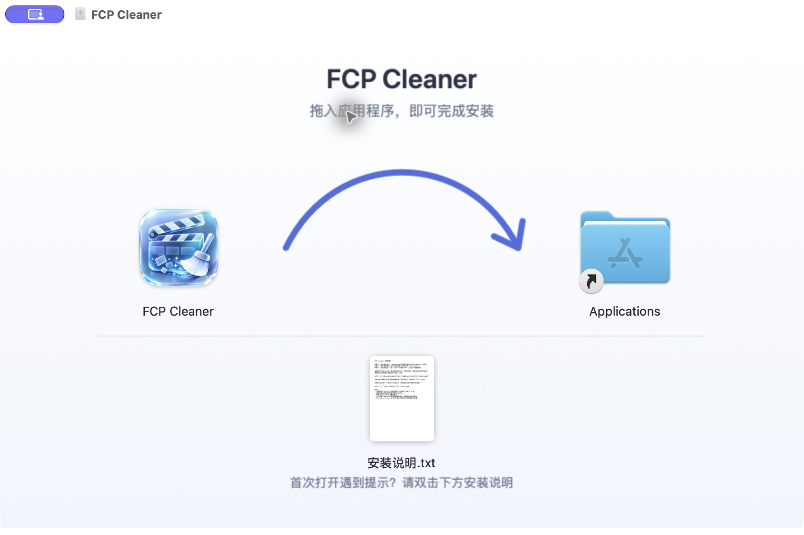

# DMG 制作与验收

安装包打开后显示左侧 `FCP Cleaner.app`、右侧指向系统应用程序目录的 `Applications` 链接，以及下方真实的 `安装说明.txt`。浅色背景中间的弯箭头从左向右、向上拱起，提示拖拽安装。

## 制作

需要 macOS、Xcode 命令行工具和正在运行的 Finder。脚本通过 AppleScript 设置 Finder 窗口，首次运行可能需要允许调用进程控制 Finder。

在仓库根目录执行：

```sh
./scripts/build_dmg.sh
```

默认从源码构建包含 `arm64`、`x86_64` 的 Universal Release，再复制 App 到临时打包目录。脚本通过 `sign_adhoc.sh` 由内向外签名 Sparkle helper、framework 和宿主，保留工程声明的 App Sandbox、用户选择文件读写、app-scoped bookmarks，以及 Sparkle 的出站网络与本应用 Mach lookup 权限，不加入 `get-task-allow` 调试权限。完成后输出 `build/releases/FCP Cleaner.dmg`。更新配置见 [Sparkle 集成](sparkle.md)。

同时输出 `.dmg.sha256` 校验文件和 `.dmg.json` 版本、架构及签名信息。脚本拒绝覆盖已有输出；再次打包时用 `--output` 指定新文件名。

使用已有 App，或指定输出位置：

```sh
./scripts/build_dmg.sh --app "build/Release/Build/Products/Release/FCP Cleaner.app" \
  --output "build/releases/FCP Cleaner.dmg"
```

`--app` 跳过源码构建，最终包的版本和架构取决于传入的 App；签名处理针对打包副本进行。

## 资源与布局

- `Resources/DMG/background.png`：900 × 560 背景，隐藏到镜像内 `.background/background.png`。
- `Resources/DMG/安装说明.txt`：UTF-8 安装步骤、首次打开的 `xattr` 命令，以及 ad-hoc 未公证说明。
- `scripts/render_dmg_background.swift`：生成背景图；修改背景后应重新制作 DMG。
- Finder 窗口为 900 × 600（包括标题栏），隐藏工具栏、状态栏和路径栏，完整显示 900 × 560 背景。图标大小 110、文字大小 14；App、Applications、安装说明的位置分别为 `(200, 245)`、`(700, 245)`、`(450, 415)`。

最终 DMG 使用 UDZO 压缩格式。应用源码、安装说明、背景资源和制作脚本均由源码发布允许列表收录；构建和镜像产物保留在已忽略的 `build/` 中。

重新绘制背景：

```sh
mkdir -p build/dmg-tools/module-cache
swift -module-cache-path build/dmg-tools/module-cache \
  scripts/render_dmg_background.swift Resources/DMG/background.png
```



## 验收

```sh
hdiutil verify "build/releases/FCP Cleaner.dmg"
shasum -a 256 "build/releases/FCP Cleaner.dmg"
open "build/releases/FCP Cleaner.dmg"
```

1. 确认卷名为 `FCP Cleaner`；重新挂载仍显示固定背景和图标布局。
2. 确认 App 在左、Applications 在右、弯箭头方向正确、安装说明位于下方，隐藏资源不占用可见图标位置。
3. 打开 `安装说明.txt`，确认中文正常、两条命令的 App 路径带引号。
4. 对挂载后的 App 执行 `codesign --verify --deep --strict --verbose=2`，并核对版本、架构和工程声明的全部权限（含 Sparkle 权限）；确认未包含调试权限。
5. 在测试环境将 App 拖入“应用程序”，从“应用程序”打开并验证首次运行。如已存在安装，先确认目标版本，避免覆盖正在使用的 App。

当前包为 ad-hoc 签名测试版，尚未进行 Apple 公证。镜像完整性、Universal 架构和本机签名验证不能代替带隔离属性的首次打开、独立 macOS 14 或 Intel Mac 设备验收。发布前按 [首版发布清单](release.md) 记录实际完成的测试，并提供同版本完整对应源码。

## 本次验证记录（2026-10-18）

本机构建 `0.1.0 / 1`，`arm64 + x86_64`，最低系统声明 macOS 14.0；最终 DMG 为 3,908,758 字节，SHA-256：

```text
704d284627730ffd493d6216a791ff66a42d0dec7e4775de505abde7149c4358
```

以下为接入 Sparkle 前的 DMG 验证记录；第二部分集成没有重新生成该 DMG，当前更新器验证见 [Sparkle 验收](sparkle.md)。

已通过 Release 构建、UDZO 校验、只读重挂载、真实 Applications 链接、背景与说明文件逐字节核对、严格签名和当时三项沙盒权限检查。使用 Finder 双击最终 DMG，窗口自动打开，布局、箭头和底部文字完整显示；在文本编辑中打开说明，中文和命令路径正常。复制到独立临时安装目录后再次验签通过；重复运行脚本会拒绝覆盖，原 DMG 校验值保持不变。

本次未向真实“应用程序”目录安装或运行 App，未执行说明中的 `xattr` 命令；带隔离属性的首次打开、独立 macOS 14 和 Intel Mac 设备验收仍待进行。原始构建日志、检查记录保留在本地忽略目录，未作为公开源码归档内容。
